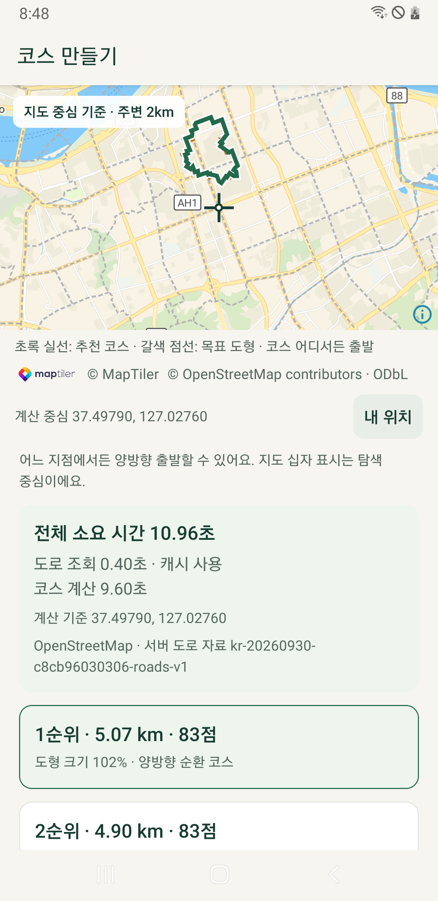
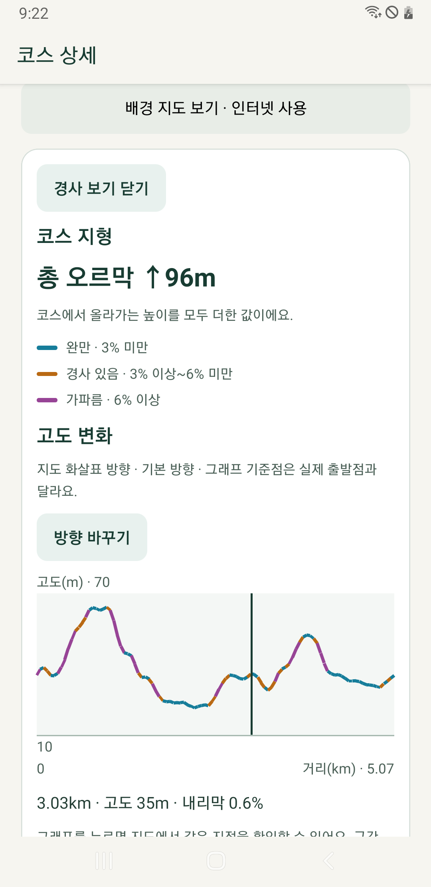

# SM-A750N 기존 기능·서버 계산 비교 — 2026-10-11

상태: **2026-10-11 21:37 KST 비로그인 실내 비교·시험 자료 정리 완료. 증거 대조 20묶음 통과.** 서버 이전으로 강남 5km 대기는 87.68초 → 10.96초, 부산 3km는 41.74초 → 6.24초로 줄었다. 아래 두 조작 관찰은 수정/재현 후속이며 모든 기능의 무결함 판정은 아니다.

## 환경과 방법

- SM-A750N / Android 10(API 29), 화면 1080×2220, 글꼴 배율 1.1, Wi-Fi·USB 충전 조건이다.
- 현재 기기에 `com.runningart.mobile.dev`가 없음을 확인하고 **20:36:59 KST 신규 설치**했다. 10-05 당시 설치 상태를 현재로 가정하지 않았다. 기존 패키지 ID·서명을 유지한다.
- APK: `build/install/running-art-0.1.0-20261010-terrain.apk`, SHA-256 `9b4426ca98a6466062c2696846057c088f9b4c6765b0cb1658a5a8d202282a32`. [같은 날 고사양폰 실내 검증](phone-followup-20261011.md)과 동일하다. 다른 대화의 10-11 Figma 변경을 포함하지 않는다.
- 비로그인·코스/러닝/좌표/메모 0건에서 시작했다. 공개 강남 하트 5km와 부산 시청 하트 3km를 같은 v0.2 자유 순환 조건으로 계산했다. 서버/기기 각 3회 및 지역별 기기 최초 다운로드 1회, 총 14회다.
- 정규 계산은 매번 새 앱 프로세스에서 시작했다. 서버와 기기 계산을 섞어 실행하되 두 지역의 최초 다운로드와 캐시 반복을 분리했다. 시간은 앱의 `ROUTE_LAB_METRICS`에서 수집했고 화면 수집/스크롤 시간은 포함하지 않는다.
- 서버 계산은 실제 Cloud Run과 전국 R2를 사용한다. 서버 제한·클라우드 설정·제품 코드·제품 APK 빌드를 변경하지 않았다. 별도 잠금·배터리 검사 중인 SM-S942N은 조작하지 않았다.

## 계산 결과

| 공개 표본 | 기기 캐시 3회 | 서버 3회 | 기기 중앙값 | 서버 중앙값 | 관측 시간비 / 대기 감소 |
| --- | --- | --- | ---: | ---: | --- |
| 강남 하트 5km | 87.68 / 87.44 / 87.76초 | 13.68 / 10.82 / 10.96초 | 87.68초 | 10.96초 | 8.00배 / 87.5% |
| 부산 시청 하트 3km | 42.01 / 41.74 / 41.68초 | 7.17 / 6.24 / 6.19초 | 41.74초 | 6.24초 | 6.69배 / 85.0% |

기기 최초 다운로드 포함 전체는 강남 **94.51초**(도로 13.69초/계산 80.82초), 부산 **45.40초**(도로 8.72초/계산 36.68초)였다. 이후 기기 반복은 다운로드 0개·강남 9파일/부산 6파일 재사용이다. 서버의 각 지역 첫 응답에는 서버 측 도로 다운로드가 포함되며 첫 응답을 임의로 중앙값에서 제외하지 않았다. Cloud Run 인스턴스의 콜드 스타트 여부까지 계측한 것은 아니다.

강남 13,614노드/15,363도로, 부산 9,181노드/9,972도로이며 동일 지역의 14회에서 입력량·탐색량과 5후보 점수(절대 오차 0.000001), 표시 거리/점수/도형 크기가 일치했다. 서버와 폰의 부동소수점 최하위 차이는 허용 오차 이내다. **모든 후보의 전체 좌표를 폰 밖으로 내보내 비교한 것은 아니다.**

[10-05 A7](a750-performance-20261005.md)의 강남 캐시 중앙값 87.03초와 이번 기기 87.68초는 비슷하며, 입력·탐색량·점수도 일치한다. 같은 최신 APK 안에서 기기/서버를 비교했으므로 이번 큰 대기 감소는 서버 사용의 효과로 볼 수 있다. APK·측정일이 다른 과거 비교 자체를 통제된 성능 시험으로 취급하지 않는다.

같은 APK의 앞선 SM-S942N 강남 중앙값은 서버 **10.30초**, 기기 **18.73초**였다. A7 서버 **10.96초**와 가까워 서버 모드에서 기기 차이가 크게 줄었다. 두 폰을 동시에 같은 부하에서 측정한 비교는 아니다.

강남 정규 3회에서 폰 타이머 최대 지연은 서버 모드 41.1ms, 기기 모드 1,705.2ms였다. 화면 프레임 측정은 아니지만 기기 계산 중 긴 JS 지연이 남음을 보여 준다. 서버 `maxSliceMs`는 서버 내부 계산 구간이므로 이 수치와 구분한다.

## 오프라인 사용의 경계

온라인 서버 계산 후 A7의 첫 기기 계산에서 강남 도로 9개를 새로 받았다. **서버 계산 성공만으로 그 지역의 기기 도로 캐시가 준비되지는 않는다.** 오프라인 사용 전에 ‘기기 계산·도로 저장’으로 지역을 준비해야 하며, 오프라인에서는 A7 자체 계산 시간이 그대로 필요하다. 실제 Wi-Fi·모바일 데이터 OFF에서 서버 선택 상태로 새 프로세스 계산을 시작하자 **기기로 전환하여 87.90초**에 완료했다. 다운로드 0개·강남 캐시 9개 재사용, 동일 입력/탐색량·5후보 점수/표시를 확인했다. 종료 후 네트워크 설정을 복원했다.

## 기능 회귀·자료 정리

| 항목 | 실제 결과 |
| --- | --- |
| 서버·기기 취소/재계산 | 양쪽 취소 후 12초 동안 늦은 성공 없음. 재계산 10.10초/87.20초, 같은 입력·탐색량·점수 |
| 계산 중 입력 | 기기 계산 중 응답 확인 카운터 1 증가 후 취소 가능 |
| 서버 결과 저장 | 하트 v2·직접 그린 도형 v3 저장/재열기, 중복 저장 방지 확인. 첫 자동 터치 관찰은 아래 별도 기록 |
| 직접 그리기 | 빈 그림·열린 선 거절, 지우기·사각형 적용, 삼각형 편집 취소 후 기존 사각형 유지. 서버 8.08초/5후보 |
| 저장 코스 경사 | 총 오르막 96m, 기본/반대/기본 복귀. 그래프 선택 3.03km/35m → 반대 방향 2.04km/35m |
| 경사 오프라인/재시도 | 같은 실행의 메모리 재사용, 새 프로세스 OFF 오류, 통신 복구 후 재시도 96m. 코스 내용 해시 유지 |
| 시뮬레이션 | 새 프로세스·실제 통신 OFF 재생/일시정지·3초 진행률 유지·처음으로 0.00km |
| GPX | 실제 Samsung 공유 선택창·GPX 파일 표시. 수신 대상을 고르지 않고 닫음 |
| 실제 GPS 기본 흐름 | 권한 허용 후 재시작, `LocationTaskService`·러닝/일시정지/재개·강제 종료/중단 복원·종료 저장/삭제. 활성 시간 55.095초, 위치 4개/제외 0개·정지 거리 0m·구간 3개 |

### 후속 수정·재현 관찰

- **이름 입력 직후 저장 첫 자동 터치:** 하트·직접 도형 두 번 모두 저장 알림이 나타나지 않았다. 키보드 닫힘 대기 1.5초를 추가한 두 번째 시험도 동일했다. 이후 새 화면 좌표로 다시 누르면 각각 저장되었고, 다음 터치에서 중복 저장을 막았다. 저장 데이터 손실·중복은 없었으나 첫 터치의 원인이 앱의 포커스 처리인지 자동화 좌표/전환인지 확정하지 못했다. 수동 터치 재현과 포커스/키보드 동작 확인이 후속이다. 이를 단순 통과나 확정된 도구 문제로 분류하지 않는다.
- **Android 10 첫 백그라운드 위치 허용:** 실제 ‘항상 허용’ 승인 후 권한은 부여됐지만 `러닝 준비를 취소했어요.`가 나타났다. 시작을 다시 누른 뒤에는 위 GPS 기본 흐름을 통과했다. `src/modules/running/runtime.ts`의 백그라운드 전환 시 준비 취소와 권한 창의 관계를 추가 확인하고, 최초 권한 승인 직후 시작 경험을 보완할 필요가 있다. 첫 도우미의 Android 10 권한 버튼 ID 차이는 별도 보정했으며, 승인 이후 이 관찰과 구분한다.

GPS 시험 기록을 삭제하고 검사 전에 없던 백그라운드 위치 권한을 해제해 되돌렸다. 계정 로그인/동기화·사진 업로드·야외 이동·장시간 배터리 결과로 확대하지 않는다.

## 최종 상태

- 이번 시험의 이름이 확인된 코스 2개와 GPS 러닝 1건을 앱에서 삭제했다. 초기와 최종 코스·러닝·좌표·메모가 모두 **0건이며 내용 해시가 일치**, 삭제 대기/충돌도 0건이다.
- 비로그인·홈 화면, Wi-Fi ON/모바일 데이터 ON/비행기 모드 OFF·글꼴 배율 1.1·동일 설치 APK 해시와 설치 시각을 확인했다. 위치 서비스 없음·설치 이후 앱 크래시 버퍼에서 해당 앱 크래시 없음이다.
- 검사 도우미 패키지와 이번 UI/제스처 임시 파일을 제거하고 부재를 확인했다. 앱의 공개 도로 캐시는 오프라인용으로 남긴다. GPX 공유 임시 파일은 앱 정책상 최소 24시간 유지 후 다음 내보내기의 정리 대상이므로 앱 캐시 전체 삭제를 주장하지 않는다.
- **A7 USB는 분리해도 된다.** 별도 SM-S942N 잠금/배터리 검사는 건드리지 않았으며 그 완료 여부는 해당 작업 기록을 따른다.

## 증거와 재현

- 실행 전 계획·경과: [실행 기록](../history/executed-plans/2026-10-11-2033-a750-server-comparison.md).
- 원본 지표/화면: Git 제외 `.cache/a750-server-comparison-20261011/`. 개인 위치·기기 식별자·계정 정보를 공유 보고서에 옮기지 않는다.
- 제어 도구: `scripts/qa/a750-server-comparison.py`, `scripts/qa/a750-features.py`. 고정된 A7 식별자와 실제 모델을 확인하고 다른 기기를 자동 선택하지 않는다.
- `scripts/qa/build-a750-ui.ps1`로 API 29용 화면/제스처 도우미를 빌드한다. `PerformanceUiDump`는 Android 10의 실제 중첩 출력 경로를 반환하며 새 파일만 수집한다. 처음 공통 화면 도우미의 경로 실패는 시험 도구 문제로 보정했고 제품 계산 실패로 세지 않았다.
- 증거 대조: `scripts/qa/verify-a750-server-comparison.py`, 20묶음 통과·[정제 결과 JSON](a750-server-comparison-20261011.json) 생성. Python 3파일 구문 확인, Android UI/제스처 도우미 빌드와 실기기 실행을 확인했다. 제품 코드·새 APK 빌드 변경이 없어 제품 전체 테스트를 다시 실행하지 않았다.

각 조건 3회·USB 충전·약 4GB급 한 기기의 결과다. 정규 14회에서 온도 30.9~34.6℃, 앱 PSS 표본 242.4~425.2MiB를 관찰했다. CPU 주파수·백그라운드 앱·온도를 통제하지 않았고 네트워크/서버 부하는 달라질 수 있다. 메모리는 표본이며 최대치·누수·배터리 지속 시간·출시 부하 검증을 뜻하지 않는다. 서버의 `maxSliceMs`는 서버 실행 구간이므로 폰의 UI 지연으로 읽지 않는다.
