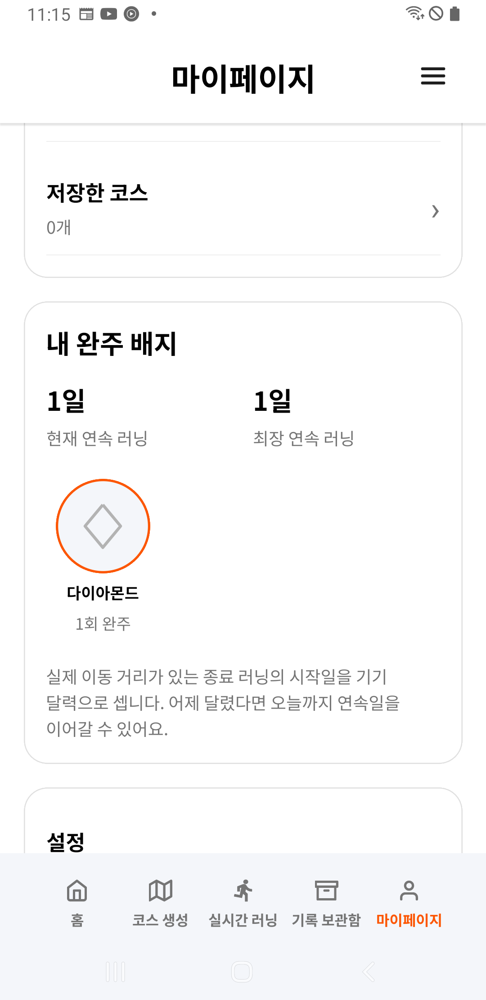
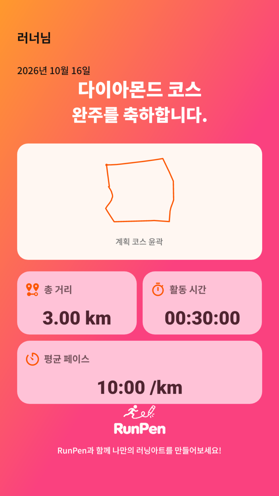
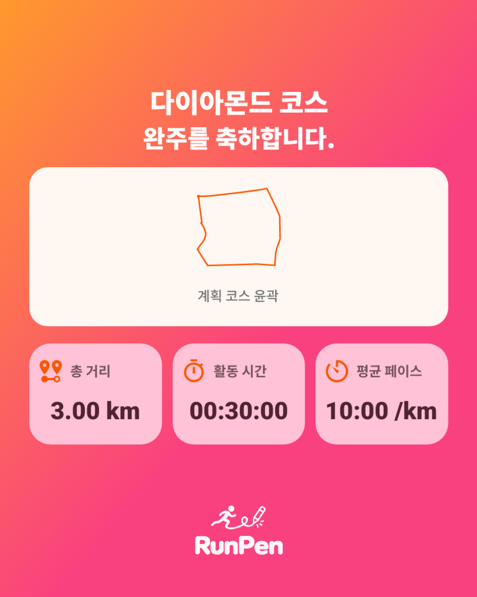
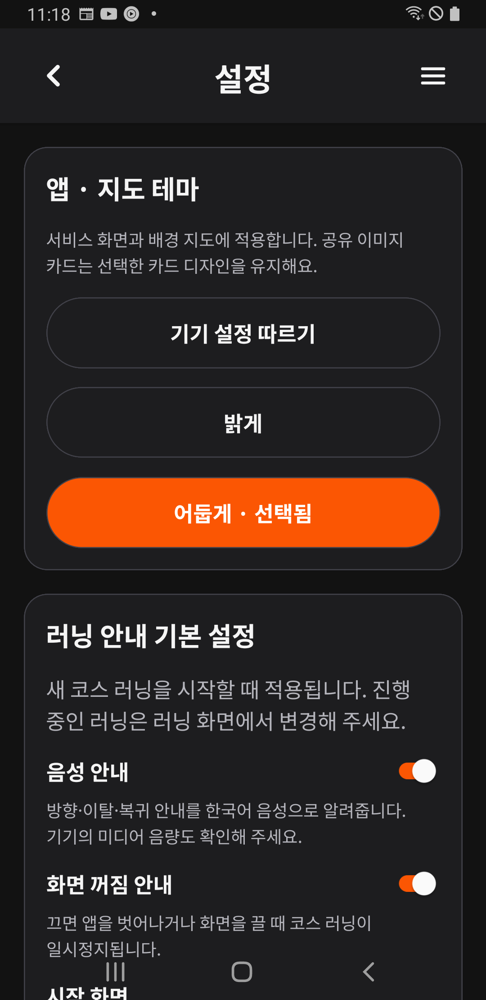
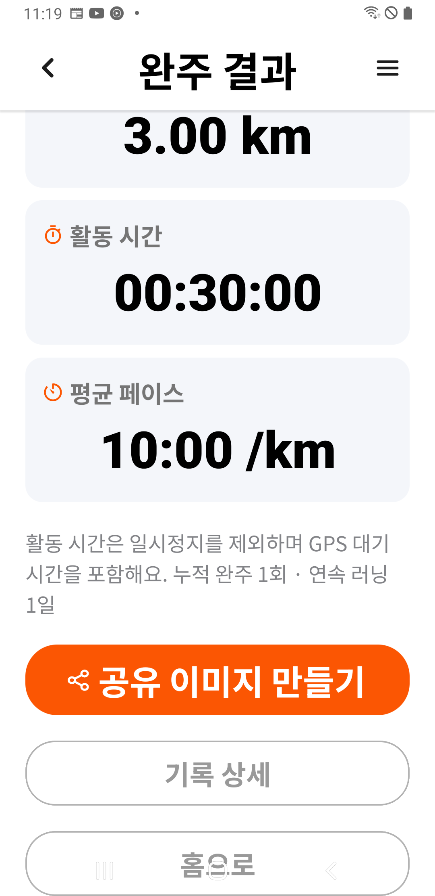

# S5·S6 휴대폰 설치·실내 검증

2026-10-16 **23:01:56 KST**, 연결된 **SM-A750N(Android 10/API 29)**에 최신 S5/S6 APK를 기존 자료 유지 방식으로 설치했다. 23:25까지 성취·PNG·게스트 지원 화면과 기본 회귀를 확인하고 시험 자료·도우미·내부 복구본을 정리했다. 원래 빈 기록·비로그인·설정·네트워크·글꼴 1.1배를 보존했으며 실행 중인 러닝 서비스가 없다. **USB 분리 가능.**

공지와 세 정책은 실제 운영 서버에서 조회 오류를 표시했다. 운영 SQL·정책 게시가 남아 있으므로 이 항목과 실제 문의/동의 제출을 통과로 처리하지 않는다. 이번에 제품 코드·운영 DB·계산 서버를 변경하지 않았다.

## 설치와 원본 보존

| 항목 | 결과 |
| --- | --- |
| APK | `running-art-0.1.0-20261014-achievements-service.apk`, 126,957,759바이트 |
| SHA-256 | `83f4e7f568d408da5eb1bdee7ac06e331dfa11c1c8f64b2258e3f4510447375c` |
| 제품 소스 | `1bfbd7d`; 같은 제품 main `6e08dcd`, 이후 인수인계 main `0d9bdb9`는 문서 변경 |
| 이전 설치본 | S1 홈, 2026-10-13 16:46:02 설치 |
| 설치 방식 | 같은 ID `com.runningart.mobile.dev`·기존 서명, `adb install -r --no-streaming`; 삭제/초기화 없음 |
| 설치 전·직후·정리 후 | 코스 0·러닝 0·좌표 0·메모 0, 네 테이블의 내용 해시 모두 일치 |
| 계정/설정 | 게스트 표시 해시·계정별 설정 전체 행·동기화 선택 일치 |
| 설치 이력 | 최초 설치 2026-10-11 20:36:59·앱 데이터 경로·앱 UID 유지 |
| 기기 설정 | Wi-Fi/모바일 데이터 켜짐·비행기 모드 꺼짐 유지, 글꼴 1.6배 시험 후 원래 1.1배 복원 |

현재 연결에서 원본을 다시 읽었으며 과거 보고서의 상태를 원본으로 가정하지 않았다. 앱 서비스가 없는 것을 확인한 뒤 DB/WAL/SHM을 기기 내부에 해시 대조해 보관했다. 전체 원본 DB나 인증 정보를 PC로 내보내지 않았다. 빈 게스트와 내부 복구본이 있을 때만 실행되는 임시 도우미로 아래 시험 기록을 추가했으며 제품 APK에는 시험 훅이 없다.

## S5 성취와 실제 PNG

원래 기록이 없어 공개 장소의 기존 다이아몬드 경로 사본으로 `QA S56 1/2/3`을 만들었다. 오늘 완주 3km/30분, 어제 완주 2km/20분, 오늘 중도 종료 1km/10분의 **합성 종료 기록**이다. GPS 좌표는 추가하지 않았으며 실제 야외 완주 검증이 아니다.

- 결과와 마이페이지에서 다이아몬드 **2회 완주·현재/최장 2일**을 확인했다. 중도 종료는 완주에 포함되지 않는다. 배지는 어제의 첫 완주 기록으로 연결됐다.
- 어제 시험 기록을 앱에서 삭제하자 **1회 완주·현재/최장 1일**로 줄었다. 홈은 남은 완주·중도 종료의 총 4.0km와 연속 1일을 표시했다. 나머지도 앱에서 삭제한 뒤 거리/러닝/완주 0, 현재/최장 0일과 배지 빈 상태를 확인했다.
- 카드의 닉네임·날짜 기본 ON, 각각 OFF 전환을 실제 스위치 상태와 생성 이미지로 확인했다. 칼로리는 없다.
- 실제 PNG는 스토리 **1080×1920**, 피드 **1080×1350**이다. 스토리는 220,572바이트, 피드는 155,095바이트이며 [정제 보고서](achievements-support-phone-20261016/report.json)에 해시를 보존했다. 두 이미지의 한글·경로·거리·시간·페이스와 숨김 상태를 눈으로도 확인했다. GPS가 없는 시험이므로 경로는 ‘계획 코스 윤곽’으로 표시된다.
- Android 공유 선택창 열기·취소, 폴더 선택 취소 후 미리보기 유지, Downloads 폴더 허용 후 실제 저장을 확인했다. 저장 파일은 미리보기 PNG와 **바이트까지 동일**하다. 외부 수신 앱을 선택하거나 전송하지 않았다.

| 삭제 전 | 어제 기록 삭제 후 |
| --- | --- |
|  |  |

| 기본 표시 스토리 PNG | 닉네임·날짜 숨김 피드 PNG |
| --- | --- |
|  |  |

## S6와 기본 회귀

| 흐름 | 실제 결과 |
| --- | --- |
| 소개·이용 방법·FAQ | 메뉴 진입/뒤로 복귀, FAQ GPS 항목 펼침과 안내 본문 확인 |
| 비로그인 문의 | ‘문의 접수 내역을 확인하려면 로그인해 주세요.’와 가입·로그인 버튼 표시; 실제 접수 미실행 |
| 공지·이용약관·개인정보·위치 약관 | 운영 조회 오류 및 다시 확인 버튼 표시. 정상 목록/본문 조회·실제 게시 완료로 세지 않음 |
| 테마 | 어둡게·밝게·기기 설정 전환, 프로세스 재시작 뒤 어둡게 선택 유지; 시험 후 원래 설정 행 복원/해시 일치 |
| 큰 글씨 | 1.6배에서 완주 공유/상세 버튼과 지원 메뉴의 마지막 정책 항목까지 스크롤 접근 확인 |
| 5탭·기록 | 홈·생성·실시간 러닝·보관함·마이페이지 이동, 홈 월간 거리·연속일, 월별 완주/중도 종료 목록 확인 |
| 새 생성 입력 | 1~10km 항목·12도형 표시, 1km/10km 선택·왕관 선택, 10km 왕관 확인창과 취소, 이미지 윤곽 입력창 진입/취소 확인 |

새 경로 계산, 실제 이미지 선택/윤곽 추출, 야외 GPS·장시간 잠금/배터리, TalkBack 발화, 소셜 재인증/로그인 계정 동기화, 실제 정책 동의·문의 접수는 이번에 수행하지 않았다. 이전 PC·격리 Android 검증을 폰 통과로 대체하지 않는다. 고사양 SM-S942N은 연결되지 않아 이번 설치 대상이 아니다.

## 정리·실패와 근거

시험 러닝 3건을 모두 앱에서 삭제했다. 생성 카드 캐시 2개·도우미의 외부 복사본·다운로드 시험 PNG·입력 JSON을 제거하고 다운로드 목록의 원상 복귀를 확인했다. 설치 전/후/최종 원본 해시, 계정 표시, 계정 설정과 동기화 선택을 대조한 뒤 내부 복구본·도우미 앱·UI jar/덤프를 제거하고 부재를 확인했다. 최종 앱은 홈이며 러닝 서비스가 없다.

실행 과정의 실패를 숨기지 않는다. APK 설치 성공 뒤 ADB 연결이 끊겨 재설치 없이 재연결/설치 해시 대조를 했다. 제한 환경의 aapt2 도우미 패키징 종료는 같은 명령의 호스트 실행으로 해결했다. 선택 사항인 Play Protect 외부 분석 전송은 거절했으며 보호 설정을 끄지 않았다. 도우미 설치 후 캡처와 설치 확인 캡처가 겹쳐 UI Automation 등록 충돌이 한 번 발생했고 이후 직렬 캡처로 진행했다.

자동 스크롤도 세 지점에서 중단됐다. 공유 옵션이 화면 위에 있어 상단으로 돌아갔고, 생성 화면에서는 고정 하단 버튼을 피하도록 시작점을 보정했다. 이미지 취소 버튼은 실제 하단 2094px를 도구가 2090px로 제한해 놓은 문제여서 관측된 버튼을 탭하고 도구 범위를 수정했다. 이후 해당 지점의 실제 동작을 확인했다. 이를 앱 수정 또는 첫 시도 전체 성공으로 표현하지 않는다.

[정제 결과/원본 증거 해시](achievements-support-phone-20261016/report.json)는 UI 조건·PNG·원본 보존·정리를 자동 대조한다. 계정/현재 위치가 담길 수 있는 원본 화면은 `.cache/s56-phone-20261016/`에만 두며, 위 공개 이미지는 합성 기록과 일반 설정 화면만 포함한다. 이번 문서 PR 검사는 문서 범위이며 기존 제품의 [최종 PR/main 검증](achievements-support-20261014.md)과 구분한다.
