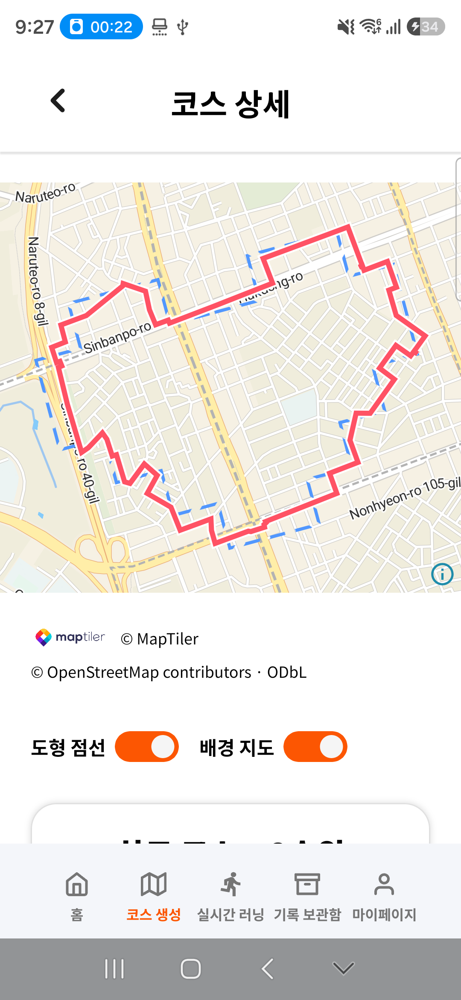
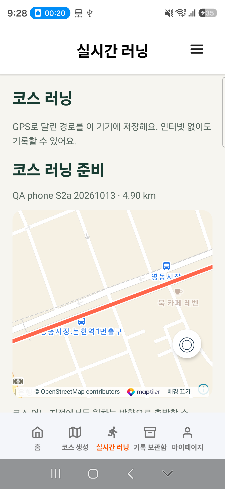

# S2a 휴대폰 설치·실내 검증

2026-10-13 21:17:49 KST, 사용자 요청으로 연결된 **SM-S942N(Android 17/API 37)**에 최신 S2a APK를 자료 유지 설치했다. 21:32 최종 대조에서 기존 **3코스·5러닝·1,659좌표·1메모의 내용 해시**, 로그인·계정 설정·동기화 선택을 보존했다. 시험 코스 삭제 동기화·도우미/내부 복구본 정리와 러닝 서비스 없음 확인을 완료했다. **USB 분리 가능.**

## 설치와 기존 자료 보존

| 항목 | 결과 |
| --- | --- |
| 설치 APK | `running-art-0.1.0-20261013-course-generation.apk` |
| APK SHA-256 | `1588a9231146303d4bf0ca27c19164dbe1b27ef1aae0b83ba2bfa0c76dc76147` |
| 이전 설치본 | S0, SHA-256 `729c60a28efd29dfb6cf857933ee9f9db87b4a81e88535b508a416620fe2992f` |
| 제품 소스 | `0289499` / 동일 제품 main `b598707`, 이번 재빌드 없음 |
| 설치 방식 | `adb install -r --no-streaming`, 앱 삭제·데이터 초기화 없음 |
| ID·서명 | `com.runningart.mobile.dev`, 기존 서명 유지 |
| 최초 설치·자료 경로 | 2026-09-27 16:29:39, `/data/user/0/com.runningart.mobile.dev` 유지 |
| 설치 전·직후·정리 후 | 코스 3·러닝 5·좌표 1,659·메모 1, 각 내용 해시 일치 |
| 계정·설정 | 로그인 표시 해시·계정 설정·동기화 opt-in 일치 |
| 연결·표시 설정 | Wi-Fi/데이터/비행기 모드·글꼴 1.0 유지 |
| 최종 동기화 | 켜짐·전송 대기 0, 삭제 대기·충돌 0 |

과거 S0 보고서의 4러닝·1,437좌표를 원본으로 가정하지 않았다. 이번 연결 시 읽은 **5러닝·1,659좌표**를 기준으로 설치 전·직후·최종을 대조했다. 러닝 서비스가 없는 것을 확인하고 원본 DB/WAL/SHM을 기기 내부에 해시 검증해 보관한 뒤 진행했다. 원본 DB 전체를 PC로 내보내지 않았다.

## 실제 확인한 흐름

- 홈·코스 생성·실시간 러닝·기록 보관함·마이페이지 5탭의 선택/복귀. 기존 기록을 사용하는 홈의 최근 러닝·월간 거리·경로 미리보기 표시도 확인했다.
- 직접 그리기의 빈 상태·실제 사각형 터치·적용·지우기 후 취소·기존 도형 복원·기본 별 도형 복귀.
- 생성 확인창 취소와 계산 시작 후 탭 이동 취소. 확인 취소만으로 계산을 시작하지 않았다.
- 강남 공개 중심(37.4979, 127.0276), 하트·목표 5km로 **실제 서버 계산 14.56초·5후보**. 후보 거리는 순서대로 5.07/4.90/5.31/5.12/4.80km다. 도형 점선 OFF/ON과 2순위 선택·상세를 확인했다.
- 저장 전 GPX/러닝 준비 비활성, 이름 입력란의 키보드 가림 없음(입력 하단 1,324px < 키보드 상단 1,372px), 탭 왕복 후 이름 유지, 명시적 저장과 재저장 시 중복 방지.
- 시험 이름 `QA phone S2a 20261013`으로 정확히 1코스만 추가됐다. 스냅샷 해시 `0bbbc69f217a0082afc1b38320c2186ea1d78f850f5f241034dc57a523ea2d48`은 같은 APK의 앞선 격리 Android 실제 강남 2순위 결과와 일치한다. 기존 러닝·좌표·메모는 이때도 해시가 같았다.
- GPX OS 공유 선택창 열기·취소와 정확한 닫힘 안내, 같은 이름·4.90km 코스의 러닝 준비 연결. GPS 기록이나 새 러닝은 시작되지 않았다.
- 다음 입력을 3km로 바꾼 뒤 이전 하트·5km 결과와 저장 이름 유지, 변경 안내, 새 프로세스에서 저장 코스 1개 재열기를 확인했다.
- 정상 앱 동기화로 시험 코스 업로드(`remoteVersion=1`, `dirty=0`)를 확인했다. 정확한 시험 코스만 앱에서 삭제한 후 삭제 전송 1건·대기 0건과 원래 전체 내용 해시 복귀를 확인했다.

## 정리와 실패 근거

원본 대조 후 내부 DB 복구본·검증 도우미 앱·이번 UI jar/덤프/토큰을 제거하고 각 경로의 부재를 확인했다. 최종 앱은 홈이며 앱 러닝 서비스가 없다. GPX는 수신 앱을 선택하지 않았으며, 공유용 임시 GPX에는 앱의 기존 캐시 보관 규칙이 적용된다. 이 캐시까지 강제로 비웠다는 뜻은 아니다.

제한 실행 환경의 ADB 연결 실패는 호스트 실행으로 해결했다. 도우미 설치 시 Play Protect의 앱 전송 선택창에서 ‘전송하지 않음’을 선택했고 보호 기능은 변경하지 않았다. 검증 스크롤 도구는 세 번 멈췄다: 도형 행의 잘린 경계, 화면 밖 항목이 XML에서 빠지는 경우, 54px 캡션을 60px 이상으로 요구한 경우다. 화면 경계·왕복 탐색·30px 기준을 보정하고 해당 지점부터 검증했다. 앱 오류나 첫 실행 전체 통과로 표현하지 않으며 제품 코드를 바꾸지 않았다.

[정제 결과와 원본 증거 해시](course-generation-phone-20261013/report.json)는 보존 대조·같은 후보 해시·저장/삭제 동기화·키보드·정리와 증거 파일 74개를 검증한다. 계정·기존 기록·개인 위치가 있는 원본 화면은 무시 경로 `.cache/s2a-phone-20261013/`에만 보관한다. 위 공개 화면은 강남 시험 후보만 포함한다.

이번은 연결된 고사양폰의 S2a 실내 후속이다. A7 최신 S2a 설치·야외 이동 GPS·장시간 잠금/배터리·TalkBack 발화·소셜 재인증·약관 동의 제출은 수행하지 않았다. 새 APK/서버/운영 DB 스키마 배포도 없다. 앞선 전체 CI 근거는 [S2a 구현 검증](course-generation-20261013.md)을 따르며 이번 문서 PR의 검사는 문서 범위다. 다음 새 기능은 S2b 12도형·거리 범위 확대다.
