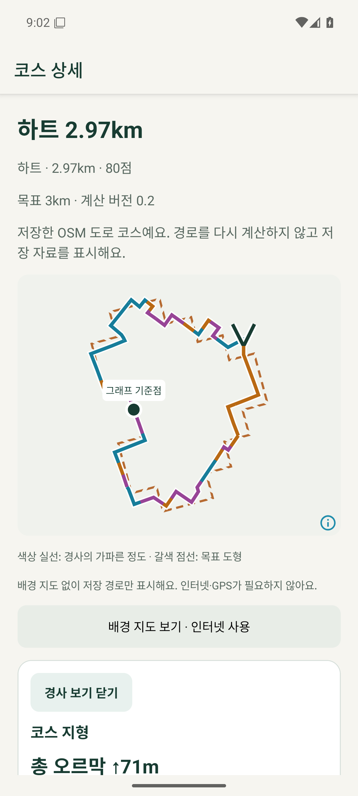
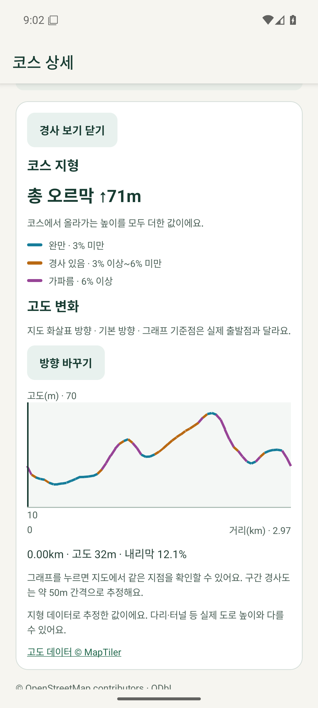
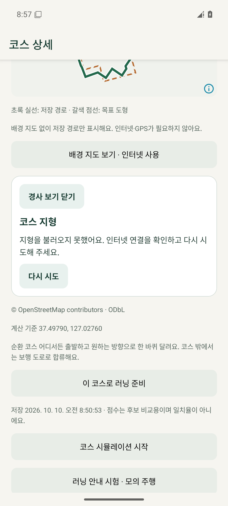

# 코스 지형 표시 검증 — 2026-10-10

## 결과

선택 후보·저장 상세의 ‘경사 보기’, 구간 색상·총 오르막·고도 그래프·지도 지점 선택·방향 전환을 구현했다. 관련 자동 검사 **93개**, 최종 지형 검사 **16개 재확인**, 타입·린트, 동일 ID/서명의 release APK, API 36 실제 화면 검증을 통과했다. 휴대폰에는 설치하지 않았으며 클라우드·요금제·DB 스키마·코스 파일 형식을 변경하지 않았다.

## 검증 환경과 증거

- Windows 프로젝트 Node 24.21.0, JDK 17, Android API 36. 이번 작업용 빈 `RunningArt_Terrain_QA` / `emulator-5560`을 사용했다. 비로그인이고 실제 사용자 자료는 없다.
- `node --test tests/terrain.test.mjs tests/route-engine-*.test.mjs tests/courses.test.mjs tests/course-gpx.test.mjs tests/route-compute.test.mjs tests/custom-drawing.test.mjs tests/running-guidance.test.mjs`: 93/93 통과. 결과는 `.cache/terrain-tests.log`.
- 고도 표본·평지·상승/하강·순환 경계·누적 상승·색상 경계·좌표/응답 검증·50좌표 묶음·중복 종료점·메모리 재사용·중간 실패·취소 경쟁·시간 제한·React Native AbortController 호환 16개. 최종 재확인은 `.cache/terrain-final-tests.log`.
- `powershell -ExecutionPolicy Bypass -File .\dev.ps1 check`: 최종 타입/린트 통과.
- `:app:assembleRelease --offline --max-workers=2 -PreactNativeArchitectures=arm64-v8a,x86_64`: 최종 1분 41초, 846 tasks 성공. `.cache/terrain-release-verified.log`.
- 최종 번들 source map의 변경 관련 8개 소스와 현재 파일 내용 일치. 설치 APK와 배포 준비 APK 해시 일치, 기존 Cloud Run APK와 서명 인증서 일치.

## 실제 서비스·Android 검증

| 시나리오 | 결과 |
| --- | --- |
| 현재 MapTiler 키의 고도 API | 공개 위치 1점 HTTP 200. 약 5,982m 폐곡선 표본은 고도 120개/표시 121점, 여러 요청으로 조회·검증 성공 |
| 후보 생성·지형 조회 | 실제 강남 3km 서버 계산의 후보 5개, 1순위 2.97km/80점. 버튼으로 조회 후 총 오르막 71m·세 색상·그래프 표시 |
| 그래프 터치·방향 | 60% 지점은 1.78km/57m. 반대 방향은 같은 실제 위치·57m에서 1.19km로 전환. 경사 부호·그래프·방향 화살표 반전 |
| 코스 저장·재열기 | 기존 저장 기능으로 1코스 저장. 상세에서 같은 지형·총 오르막 표시. 조회가 코스 저장 파일을 바꾸지 않음 |
| 같은 프로세스의 오프라인 | Wi-Fi·데이터 OFF에서 이미 조회한 결과를 메모리로 표시 |
| 새 프로세스의 오프라인 | 최종 캐시 보정 후 오류와 ‘다시 시도’, 원래 초록 경로 유지. 숫자 0m·빈 그래프를 성공으로 표시하지 않음 |
| 온라인 복구 | 네트워크 복구 후 수동 재시도로 실제 고도·71m 복원 |
| 러닝 준비 | 패널을 닫고 같은 코스의 기존 ‘코스 러닝 준비’ 화면 진입. 실제 GPS 러닝은 시작하지 않음 |
| 최종 시각 확인 | 기준점에서 떨어진 방향 화살표를 양방향으로 확인. 고도 패널 전체 문구·범례·그래프가 잘리지 않게 스크롤 가능 |

수치는 이 시험 입력의 **지형 데이터 추정치**이며 실제 도로 높이 측정이나 정확도 검증 결과가 아니다. 캡처의 Android 시계는 UTC, 이 문서 실행 시각은 KST다. UI 원본·중간 증거는 `.cache/terrain-qa/`에 있다.

## 검증 중 수정

- Android의 기본 OkHttp 10MiB 디스크 캐시가 새 프로세스에서도 기존 고도 응답을 재사용했다. 네트워크 기본 경로 없음과 프로세스 종료를 확인한 뒤 고도 요청에 `Cache-Control: no-cache, no-store`를 추가했다. 기존 캐시가 있는 AVD에서도 최종 새 프로세스/오프라인 오류·온라인 재시도를 검증했다.
- 축소 지도에서 화살표가 기준점 라벨에 가려졌다. 기준점에서 가장 멀리 떨어진 표본 지점의 실제 도로 방향으로 옮기고 코스 길이에 맞춰 화살표 크기를 제한했다. 마지막 APK의 양방향 화면으로 대조했다.
- React Native AbortSignal에는 `throwIfAborted`가 없을 수 있어 `aborted` 검사로 구현하고 실제 네이티브 polyfill로 테스트했다.

## 자료 보존과 APK

시험 코스 1건의 전체 저장 행 SHA-256은 표시 전·후·최종 재설치 후 모두 `98631ed69ee0f6f94d8b4b64a1060b5b2d10c39cc97f7d45cfeec096f21cb2f3`으로 같다. SQLite 버전 7 유지. 최종 앱 서비스 없음, 임시 화면 덤프 제거, 시험 AVD 종료. 실제 휴대폰·계정·Supabase·R2·Cloud Run 설정에는 쓰지 않았다.

- 파일: `build/install/running-art-0.1.0-20261010-terrain.apk`
- 크기: **114,314,219바이트**, arm64-v8a/x86_64.
- APK SHA-256: `9b4426ca98a6466062c2696846057c088f9b4c6765b0cb1658a5a8d202282a32`
- 앱 ID: `com.runningart.mobile.dev`, 버전 0.1.0.
- 서명 인증서 SHA-256: `fac61745dc0903786fb9ede62a962b399f7348f0bb6f899b8332667591033b9c`.

## 범위와 남은 검증

이 기능은 온라인 지형 표시다. 추천/난이도 점수 반영·고도 영구 저장/동기화·GPX 고도 추가·실시간 경사 안내는 구현하지 않았다. 휴대폰 설치·야외 도로 높이 정확도·접근성 서비스 실제 발화·장시간 성능은 후속이다. 기존 Gradle deprecation·SDK XML 버전 경고는 빌드 실패가 아니며 이번에 도구 버전을 변경하지 않았다.

[사용법·계약](../development/course-terrain.md) · [실행 전 계획과 결과](../history/executed-plans/2026-10-10-1732-course-terrain.md)
