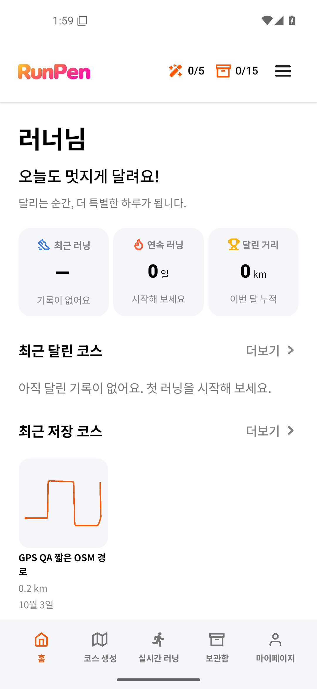

# PR57 Android 실패·재실행 원본

- Actions: https://github.com/ssw3131/running-art-mobile/actions/runs/42627593891/attempts/1
- job129195378359, artifact13680118739 (`android-36-1`).
- ZIP SHA-256: `2193ae73393cd6b02ae676d1cd39f1a6ba37e10e8f4252d6cc95e750c4d0a7cd`.
- 보고서·로그·실패 PNG는 내려받은 ZIP에서 내용 변경 없이 보존했다. 로그는 문서 전용 검사를 따르도록 확장자만 `.md`로 바꿨다. 전체 XML/PNG/로그는 원본 artifact에 있다(7일 보존).
- [report.json](android36-attempt1-report.json): 가입 게이트/동의 통과, S0-01-maestro 실패, cleanup 실패.
- [maestro.log](android36-attempt1-maestro.md): 첫 launchApp의 `device offline`, deviceInfo의 `UNAVAILABLE`.
- [device-logcat.txt](android36-attempt1-device-logcat.md): adbd 연결 write failed 뒤 새 host 연결.
- [failure.png](android36-attempt1-failure.png): 실패 뒤 앱 홈과 다섯 탭이 표시된 원본 캡처.

최초 실패를 새 성공 결과로 덮어쓰지 않는다. 재실행·병합 결과는 [기존 실행 기록](../../../history/executed-plans/2026-11-09-2110-sharing-platforms.md)에 이어 적는다.

## 동일 소스 재실행 결과

- [2회차](https://github.com/ssw3131/running-art-mobile/actions/runs/42627593891/attempts/2): Android36 job129239492606·verification-gate129263600977 통과.
- Android36 artifact13687697674 (`android-36-2`), ZIP SHA-256 `fa6fe5d61bca757f36c333dd74af58c06b74133c0cb7f9d8c3eca263caa34bcc`.
- [기능 원본](android36-attempt2-report.json): full15단계·자료 보존·정리 통과, 시나리오 재시도0, UI 덤프 준비 대기8건/완료 후 전송 경고0건.
- [화면 비교 원본](android36-attempt2-visual-report.json): 기존4화면 차이0. 기준·마스크·임계값 변경 없음.
- [Android29 원본](android29-attempt1-report.json): 처음부터 smoke7단계·자료 보존·정리 통과, 시나리오 재시도0.
- [필수 게이트 영수증](verified-attempt2.json): tree `be7ecb351c91ba4bbd507a7f109cdd6227a3a080`, artifact13686994833. ZIP SHA-256 `e1131a1bce85b87cfe51762e45525fe08ea478333bdbfd59b11a19f8b7029a5b`.

제품·QA 코드와 이미지 기준을 수정하지 않고 실패 작업만 1회 재실행했다. ADB 단절은 이 재실행에서 재현되지 않았으나 최초 단절을 일으킨 근본 원인까지 확정한 것은 아니다.

## main 확인

PR57은 main `8c7ab9feb91ee23c759f31ea8296e2fa8ee8ad00`에 squash 병합됐다. [main 실행248/42647618713](https://github.com/ssw3131/running-art-mobile/actions/runs/42647618713)의 필수 게이트는 [동일 트리 성공 증거](main-reuse.json)를 재사용해 통과했다. main에서 Android를 새로 실행한 것이 아니다.
