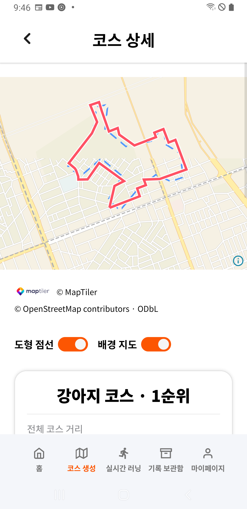
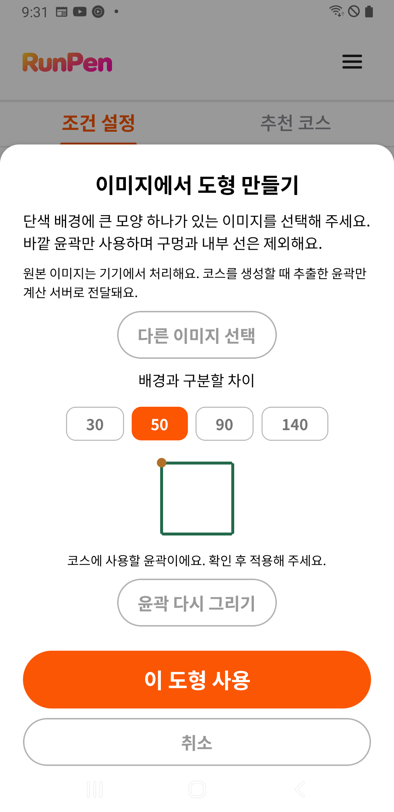

# A7 운영 계산·이미지 입력 후속 — 2026-10-17

기기 SM-A750N(Android 10), 비로그인 상태에서 공개 강남 표본을 사용했다. 10-16 23:01:56에 설치한 기존 APK를 유지했고 이번에 앱을 재설치하지 않았다. APK SHA-256은 `83f4e7f568d408da5eb1bdee7ac06e331dfa11c1c8f64b2258e3f4510447375c`다. 서버 변경은 [운영 후속 검증](operations-readiness-20261017.md)을 따른다.

## 생성·저장·재열기

| 입력 | 운영 리비전 | 화면 전체 시간 | 후보 |
| --- | --- | ---: | ---: |
| 하트5km | 기존 `00002-nog` | 14.95초 | 5 |
| 강아지3km | 신규 `shapes1017` | 6.06초 | 5 |
| 딸기10km | 신규 `shapes1017` | 12.59초 | 5 |

세 결과의 후보 점수·도로 노드/구간·탐색량과 다섯 후보의 표시 거리는 같은 공개 고정 입력의 기준 엔진과 정확히 일치했다. 화면에서 서버 계산을 확인했으며 기기 대체 계산을 서버 성공으로 기록하지 않았다. 단일 확인 시각의 결과로 성능 개선의 반복 통계가 아니다. 딸기10km는 결과 확인 후 저장하지 않았다.

- 하트2순위4.90km를 `QA-20261017-heart5`로 저장했다. 첫 저장 터치·중복 방지, Android GPX 공유 선택창/취소·닫힘 안내, 같은 이름/거리의 러닝 준비, 앱 재시작 후1건 유지·재열기를 확인하고 정확한 시험 코스만 삭제했다.
- 강아지1순위3.09km를 `QA-20261017-dog3`로 저장했다. 첫 저장·중복 방지·재시작 후 강아지 아이콘/이름·재열기와 시험 코스 삭제를 확인했다.
- 러닝 준비는 정확한 현재 위치가 필요하다는 안내까지다. GPS 기록은 시작하지 않았으며 실제 러닝·완주·야외 정확도 통과를 뜻하지 않는다.
- 10-11의 첫 저장 터치 무반응은 이번 두 저장에서 재현되지 않았다. 당시 원인을 확정하거나 모든 상황의 미재현을 보장하는 것은 아니다.
- 비로그인 검증이므로 업로드/삭제 동기화까지 시험한 것은 아니다. GPX 수신 앱을 선택하지 않았고 공유 임시 GPX에는 앱의 기존 캐시 보관 규칙이 적용된다.

## 실제 이미지 윤곽

흰 배경/검은 사각형256×256 PNG를 새 고유 이름으로 만들었다. Android 사진 선택창 → 실제 자르기 → 윤곽 미리보기/적용 활성 → 이 도형 사용 → 공개 강남/사용자 도형5km 생성 확인 → 취소를 확인했다. 실제 개인 사진은 선택하지 않았다. 이미지로 생성된 윤곽의 계산 실행은 이 사례에 포함하지 않는다.

시험 이미지의 파일 해시·미디어 행/경로를 확인해 해당 파일과 행만 삭제했다. 기기 내 ImagePicker의 시험 PNG 임시 파일2개도 생성 시각·경로·크기/해시를 대조해 제거했다. 기존 도우미는 JPEG/HEIC만 정리하므로 로컬 사본의 확장자 허용에 PNG만 추가해 사용했다. 제품 코드/APK나 공유 QA 소스는 수정하지 않았다. 다른 사진·기존 캐시를 지우지 않았다.

## 원본 보존·정리

검증 전 러닝 서비스가 없음을 확인하고 DB/WAL/SHM·설정 복구본을 기기 내부에 보관했다. 최종 대조에서 기존 코스0·러닝0·좌표0·메모0의 내용 해시, 비로그인 계정 식별 해시·설정이 일치했다. APK 해시·최초 설치/최종 갱신 시각·자료 경로·사용자 ID·Wi-Fi/모바일 데이터/비행기 모드·글꼴1.1도 전후 완전히 일치했다. 원본 DB 전체를 PC로 내보내지 않았다.

시험 코스·이미지·미디어 행·시험 PNG 캐시, 기기 내부 복구본, 검증 도우미·UI jar/덤프를 정리했다. 마지막 홈 화면·러닝 서비스 없음까지 확인했으며 USB를 분리해도 된다. [정제 증거](operations-phone-20261017.json)에 실제 비교·정리 결과를 보존한다.

## 실제 화면

공개 강남 표본의 새 강아지 코스와 합성 이미지의 윤곽 미리보기다. 개인 위치·사진을 증거로 게시하지 않았다.

## 진단 이력과 범위

제한 환경 ADB 실행 실패는 정상 호스트 실행으로 해결했다. 도우미 설치의 Play Protect 전송 선택창에서는 ‘전송하지 않음’을 선택했고 보호 기능은 변경하지 않았다. 예전 스크롤 좌표·표본 ID·화면 밖 후보 탐색 실패는 현재 화면 컨트롤과 스크롤 영역으로 검증 도구만 보정했다. 잘못된 후보 선택 시 상세의1순위를 확인한 후 돌아가2순위를 실제 선택했으며 실패를 성공으로 대체하지 않았다. 미디어 조회의 인용 오류·Windows 도구 출력 인코딩 문제도 조회/검증 도구에서 수정했다.

12도형×10거리 전체의 휴대폰 실계산, 고사양폰 최신 기능, 실제 야외 이동·장시간 무충전, 실제 가입 동의·문의 접수는 이 검증의 완료 범위가 아니다. 원본 증거는 `.cache/operations-phone-20261017/`와 이번 명령 로그에 보존한다.
