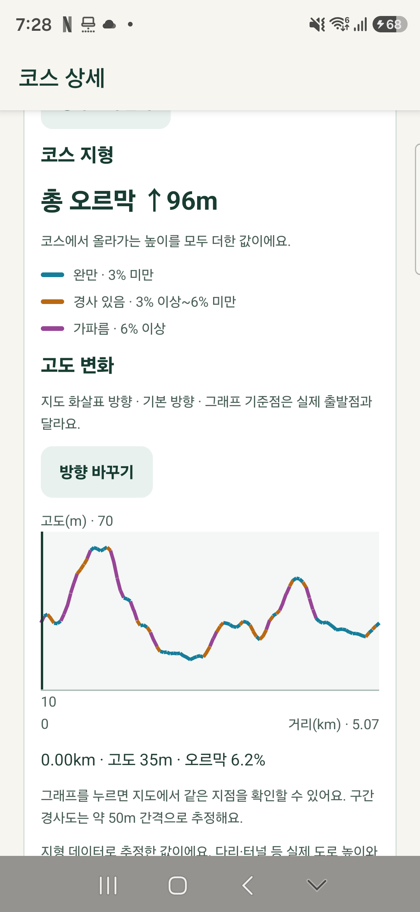
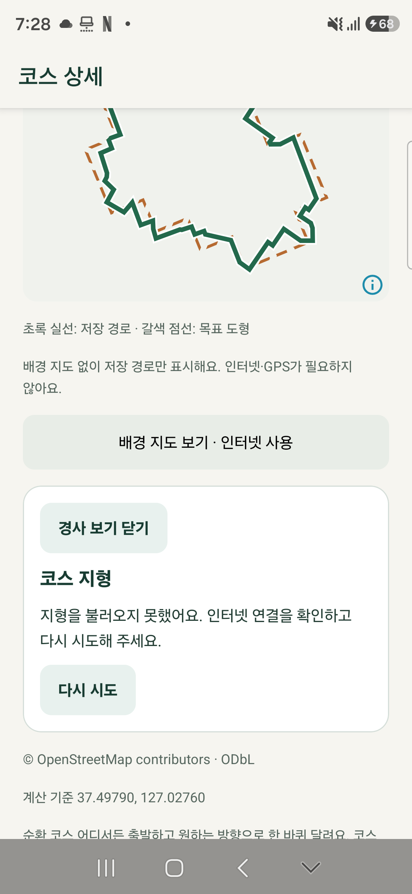

# 완료 기능의 휴대폰 후속 검증 — 2026-10-11

**같은 날 21:57 후속:** 실제 잠금 검사에서 30분 이상 위치 저장은 확인했으나 21:04 앱 자동 백업과 같은 시각 프로세스 종료·복귀까지 기록 중단을 발견했다. 사용자 최종 충전 시각은 21:47경이며 약 79분 전체 기기 94%→93%, 연속 GPS 배터리 통과는 아니다. 시험 자료/도우미 정리·원래 내용 해시/계정 보존 완료. 아래 ‘잠금 미시작’은 실내 검증 종료 당시 상태이며 [후속 결과](phone-lock-battery-20261011.md)를 우선한다. 저사양 후속은 [별도 A7 검증](a750-server-comparison-20261011.md)을 따른다.

상태: **실내 검증·정리 완료, 전체 요청은 부분 완료**. 사용자가 요청한 ‘폰 미검증 항목’ 중 다른 채팅에서 진행 중이던 Figma 공통 컴포넌트는 제외했다. 연결된 **SM-S942N·Android 16**에서 아래 항목을 직접 확인했다. 야외 이동·30분 이상 잠금·충전 해제 배터리·추가 물리 기기 검사는 남아 있다.

## 설치본과 범위

- 2026-10-11 **19:09:47 KST**에 기존 `build/install/running-art-0.1.0-20261010-terrain.apk`를 자료 유지 업데이트했다. 제품 기준은 `e2df8f9`의 지형 표시와 앞선 Cloud Run 연결이다. 검증 중 다른 대화에서 완료·커밋한 10-11 Figma 변경은 이 APK에 없다.
- APK 114,314,219바이트, SHA-256 `9b4426ca98a6466062c2696846057c088f9b4c6765b0cb1658a5a8d202282a32`. 설치 직후와 최종 `base.apk` 해시 일치.
- 앱 ID `com.runningart.mobile.dev`, 버전 0.1.0, 서명 SHA-256 `fac61745dc0903786fb9ede62a962b399f7348f0bb6f899b8332667591033b9c` 유지. 최초 설치 `2026-09-27 16:29:39`와 자료 경로 유지.
- 이번 변경은 QA 도구·검증 문서다. 제품 코드를 수정하거나 새 제품 APK를 빌드하지 않았고 서버 설정·배포도 변경하지 않았다. 기존 서비스로 시험 코스 저장·삭제 동기화를 수행했다.

| 항목 | 이번 상태 | 근거·경계 |
| --- | --- | --- |
| Cloud Run·기기 계산 | 통과 | 각 3회, 취소/재계산, 실제 네트워크 OFF 자동 전환 |
| 후보·저장 코스 경사 | 통과 | 실제 고도 조회, 색상/그래프/방향, 저장·재열기, 오프라인·재시도 |
| 그래프 접근성 조절 | 통과 | Android 접근성 증가·감소로 값 변경·복귀. TalkBack 음성 청취는 미검증 |
| EXIF JPEG·HEIC·48MP | 통과 | 실제 선택기·자르기·512px 가공·메타데이터 제거. 원래 프로필에 저장하지 않음 |
| 위치 OFF·대략적 위치 | 통과 | 정확한 오류, 시작 차단, 설정/권한 플래그 원상 복구 |
| 실제 GPS 기본 흐름 | 통과 | 정지 상태 수신, 일시정지·재개·강제 종료 복원·종료/저장 |
| 이전 휴대폰 검증 완료 기능 | 기존 근거 유지 | 직접 그리기/GPX/공유, 소셜, 개인 동기화·복원/충돌, 사진 서버·탈퇴, 추가 지역 4곳은 10-05 보고서 참조 |
| 다른 채팅의 Figma 작업 | 이번 범위 제외 | 사용자 명시. 기존 APK만 시험 |

## 서버·기기 계산

공개 강남 표본 중심 `37.4979, 127.0276`, 하트·5km·주변 2km를 사용했다. UI가 기록한 전체 소요 시간이며 ADB 화면 수집 대기 시간은 포함하지 않는다.

| 방식 | 전체 1/2/3회 | 중앙값 | 도로 조회 1/2/3회 | 계산 1/2/3회 |
| --- | --- | ---: | --- | --- |
| 서버 | 13.89 / 10.30 / 9.62초 | **10.30초** | 2.13 / 0.35 / 0.35초 | 9.57 / 9.57 / 8.91초 |
| 기기 | 19.31 / 18.42 / 18.73초 | **18.73초** | 2.64 / 1.57 / 1.57초 | 16.67 / 16.84 / 17.15초 |

이 기기·표본·3회에서 서버 전체 중앙값이 약 45% 짧았다. 서버 첫 회는 도로 다운로드, 나머지는 캐시다. 기기 세 회는 기존 도로 캐시를 썼다. 순차 실내 시험으로 일반적인 속도 보장·엄밀한 cold start·저사양 폰 개선 실증은 아니다.

서버/기기 6회, 오프라인 전환, 취소 후 재계산의 **8개 완료 결과 모두** 5개 후보의 순위·거리·점수·크기 표시가 같았다: `5.07km/83/102%`, `4.90km/83/100%`, `5.31km/82/104%`, `5.12km/82/96%`, `4.80km/81/94%`. 노드 13,614·도로 연결 15,363도 같았다. 이번 휴대폰에서는 UI 요약을 비교했으며 전체 좌표 JSON 해시 대조는 [기존 서버 검증](cloud-run-routes-20261010.md)의 범위다.

- Wi-Fi·모바일 데이터 OFF에서 ‘서버 연결 대신 기기에서’ 표시와 캐시 계산 성공: 전체 **20.71초**, 도로 1.84초·계산 18.85초. 같은 앱 프로세스에서 검사했다. 새 프로세스의 지역별 오프라인 도로 캐시는 [10-05 검증](indoor-phone-validation-20261005.md)을 따른다.
- 실제 서버 계산 중 취소 상태 10.8초를 확인하고 추가 12초 후에도 취소 상태가 유지됐다. 다음 계산은 9.91초에 같은 후보 5개로 완료됐다.
- 실제 휴대폰에서 HTTP 429/503을 새로 유발하거나 로그아웃 상태를 반복 검사하지 않았다. 과부하 응답·서버 보호의 기존 PC/Android QA 근거와 구분한다.

## 경사 표시

강남 1순위 5.07km를 조회해 총 오르막 **96m**·세 구간 색상·고도 그래프를 확인했다. 그래프 선택 시 `3.03km / 35m`, 방향 전환 후 같은 실제 지점은 `2.04km / 35m`로 표시됐다. 선택점에서 다음으로 나가는 구간이 달라지므로 전환 전후의 인접 구간 경사 수치가 단순 부호 반전인지는 이 지점만으로 판정하지 않았다.

`QA phone 20261011 terrain`으로 저장·다시 열기 후 같은 96m를 표시했다. 같은 프로세스의 네트워크 OFF에서는 메모리 결과를 재사용했고, 강제 종료 후 네트워크 OFF에서는 원래 초록 경로와 오류·‘다시 시도’를 표시했다. 온라인 복구·재시도로 96m를 복원했다. 저장 직후와 후속 검사에서 시험 코스 snapshot 해시가 같았다.

Android 접근성 증가·감소 액션은 `0.00km / 35m → 0.05km / 38m → 0.00km / 35m`로 바뀌었다. 최초 도우미가 액션 반환값 `false`만으로 실패 판정한 것은 수집기 오류였다. 현재 React Native delegate가 JS 이벤트를 전달한 뒤 기본 View 반환값을 내보내므로 실제 선택값 변경·복귀로 판정하도록 고쳤다. 제품 변경은 없으며 실제 화면 읽기 서비스의 발화는 듣지 않았다.

이 수치는 지형 데이터 추정값이다. 실제 보행 도로·다리/터널의 높이나 야외 경사 정확도를 검증한 것은 아니다.

## 사진 형식

개인 사진 대신 식별 가능한 합성 그림 3개를 만들고 공개 강남 위치의 GPS EXIF를 넣었다. Android의 지정 시험 앨범에서 선택→자르기→앱 미리보기를 수행했다. 최종 JPEG의 APP/COM 세그먼트가 없어 GPS EXIF 등 메타데이터가 제거됐음을 확인했다.

| 원본 | 입력 크기 | 최종 JPEG | 결과 |
| --- | --- | --- | --- |
| EXIF JPEG | 1200×800, 37,818바이트, orientation 6 | 512×512, 9,291바이트 | 통과 |
| HEIC | 1200×800, 22,792바이트, orientation 1 | 512×512, 9,805바이트 | 통과 |
| 48MP JPEG | 8000×6000, 901,891바이트, orientation 6 | 512×512, 9,911바이트 | 통과 |

48MP 원본은 단순 도형이라 압축 파일 크기는 약 0.9MB다. 고해상도 디코딩을 확인했지만 수십 MB의 복잡한 실제 사진까지 검증한 것은 아니다. 세 결과 해시는 [정제 보고서](phone-followup-20261011.json)에 있다. 이번에는 업로드 저장을 누르지 않았고 원래 계정 프로필을 유지했다. 실제 사진 서버 왕복은 [10-05 검증](remaining-verification-20261005.md)의 별도 완료 항목이다.

## 실제 위치 권한·GPS

- 위치 OFF에서 ‘기기의 위치 기능을 켠 뒤 다시 시작해 주세요.’, 대략적 위치만 허용한 상태에서 정확한 위치 안내와 시작 차단을 확인했다. 위치 ON과 coarse/fine/background 권한·플래그를 시작 전과 정확히 맞췄다.
- 실제 `LocationTaskService`를 확인하고 위치를 수신했다. 일시정지 17초·재개 후 강제 종료/재시작에서 ‘기록 중단’과 마지막 저장 상태 복원, 재개·종료·저장을 통과했다.
- 시험 기록의 활동 시간 **39.813초**, 저장 위치 **5개**, 제외 위치 **5개**, 거리 **0m**. 새로 받은 위치는 실제 GPS이나 정지·실내 시험이며 GPS 정확도, 제외 원인 전체, 실제 이동 거리 오차를 판정하지 않는다. 개인 좌표 원문은 기기 밖으로 추출하지 않았다.

## 기존 자료 보존·정리

검증 시작 시 실제 기기에 있던 자료를 기준으로 삼았다. 과거 보고서의 코스 2개가 아니라 **3개**였다. 기기 내부 SQLite 사본을 먼저 만들고, 시험 코스 1개·GPS 기록 1개만 앱에서 삭제·동기화한 뒤 아래 내용 해시를 대조했다. 동기화 버전 등 운영 메타데이터는 제외하고 코스·러닝의 사용자 내용과 안내 정보, 전체 GPS 좌표, 메모를 비교한다.

| 자료 | 전·후 개수 | 전·후 동일 SHA-256 |
| --- | ---: | --- |
| 코스 | 3 | `5d60985a10271c63f0cc7ca75868b83798f0f0b8c0c6f4a819ce0b4a92008e8a` |
| 러닝 | 2 | `f3ce10eed8596e1c0b8d04380f55288b73f21ddf1ca129f133b993cb2f7dd34b` |
| GPS 좌표 | 209 | `b6ef3a573ec5334bdfb353f8ec06ca8ffc0c3f5d5ab4503b292bbeb80a57c96b` |
| 메모 | 1 | `c30c777c63fa7efd60cbec6bd4d09ed534a62aaa8d49c458e3c2630e05798067` |

원래 Google 이름/이메일의 동일성을 해시로 확인했고, **동기화 켜짐·전송 대기 0건**, 삭제 대기·충돌 0건이다. 마지막 수동 동기화 완료 UI 시각은 **19:59:09 KST**다. 이번에는 서버 전체 행/객체의 별도 관리자 해시 감사를 하지 않았다.

시험 갤러리 3파일/미디어 행과 빈 폴더, 시험 중 생긴 사진 캐시 12파일, 기기 내부 DB 백업, `com.runningart.authdigest` 도우미, 이번 UI 덤프·제스처 도우미를 제거했다. Wi-Fi/모바일 데이터 ON·비행기 모드 OFF·위치 ON, 최종 실행 서비스 없음·원래 계정 화면 복귀를 확인했다. **USB를 분리해도 된다.** 충전 중 56→84%였으므로 이 기록은 배터리 소모 검사가 아니다.

## 검증 도구와 증거

- `scripts/qa/build-phone-validation.ps1`: Android SDK/JDK 17로 자료 요약·접근성 도우미 빌드/서명 성공. 앱 제품 빌드와 구분한다.
- `scripts/qa/phone-followup.py`: 지정 실기기의 화면·실제 입력·네트워크·설정·자료 해시 수집. 화면 수집/스크롤 실패 시 새 XML을 확인해 진행했으며 오래된 덤프를 통과 근거로 쓰지 않았다.
- `scripts/qa/phone-photo-fixtures.py`: `.cache`의 QA 전용 Pillow/pillow-heif로 합성 원본 생성. 앱 의존성은 변경하지 않았다.
- `python scripts/qa/verify-phone-followup.py`: **17개 증거 대조 묶음 통과**, [정제 JSON](phone-followup-20261011.json) 생성. 제품 단위 테스트 17개를 새로 실행했다는 뜻은 아니다.
- 원본 UI/화면·기기 상태는 ignored `.cache/phone-followup-20261011/`에 있다. 공유 문서에는 계정 이름/이메일·인증 값·개인 GPS·개인 갤러리 화면을 넣지 않았다. 공개 시험 위치 화면 2장만 복사했다.

## 남은 실기기 검증과 재개 조건

| 미완료 | 필요한 조건 |
| --- | --- |
| 실제 코스 이동·합류/이탈·복귀·양방향 완주·높이/거리 정확도 | 사용자의 야외 이동과 비교 기준. 이번 정지 GPS 시험으로 대체할 수 없음 |
| 실제 GPS 30분 이상 잠금·오프라인 안내·절전·충전 해제 배터리 | 종료 후 사용자가 직접 보안 잠금을 풀 수 있는 시간과 충전 해제. 가능 여부 질문에 아직 답이 없어 잠금 시험을 시작하지 않음 |
| 재부팅·OS 메모리 회수·제조사 절전 | 복귀/잠금 해제 가능한 시간, 별도 기록 복구 시나리오. `force-stop`은 이번 통과했으나 이 조건과 동일하지 않음 |
| 두 물리 휴대폰 동기 사용·최신 APK 저사양 성능 | 두 번째 폰 연결. SM-A750N의 10-05 설치/성능 완료 근거를 이번 Cloud Run/지형 APK 결과로 대체하지 않음 |
| 다른 기기 프로필 즉시 반영 | 이전에 남은 갱신 정책/구현 문제 재현·개선 후 두 세션 검증. 이번 원래 프로필 유지와 별개 |
| TalkBack 실제 발화·다른 제조사/사진·iOS | 해당 접근성 서비스·기기 환경. 접근성 액션 전달만 통과 |

다른 대화의 Figma 후속 적용, 미구현 서비스 화면/추천 경사 반영, 네이버 공개 검수·스토어 출시·운영 도메인·서버 예산 메일 수신 실증은 이번 휴대폰 기능 검사의 완료 대상으로 포함하지 않는다.

[실행 전 계획·결과](../history/executed-plans/2026-10-11-1904-phone-verification.md) · [현재 상태](../handoff/status.md)
