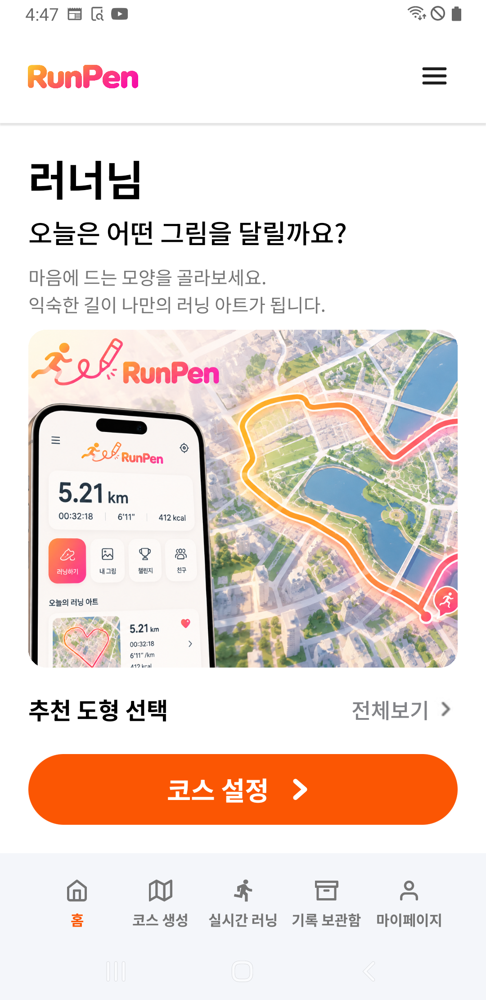
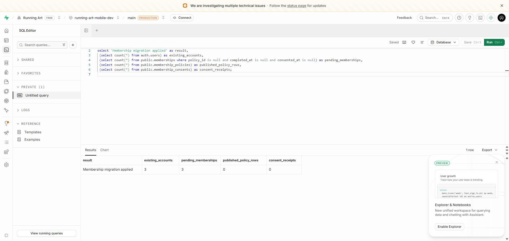

# S1 저사양폰 설치·운영 DB 적용

2026-10-13, Asia/Seoul. 사용자의 “저사양 폰 연결되어 있어 / 휴대폰 설치·운영 DB 적용 먼저하자”에 따른 수동 적용이다. **SM-A750N 설치와 기존 모바일 Supabase의 회원/동의 스키마 적용을 완료했다.** 약관 게시와 실제 가입 동의 완료는 별도 후속이다. 앱 코드·APK 재빌드·S2 개발·자동 배포 설정은 변경하지 않았다.

## 휴대폰

- SM-A750N, Android 10/API 29, arm64. 16:46:02 KST에 `running-art-0.1.0-20261013-home-final.apk`를 `adb install -r --no-streaming`으로 자료 유지 업데이트했다.
- 설치 전 10-11 지형 APK의 SHA-256은 `9b4426ca98a6466062c2696846057c088f9b4c6765b0cb1658a5a8d202282a32`, 설치 후는 **`1b610b4f93364211a079a06608b826ccda9af6689f98ad12a0ec11680518a130`**이다. 최종 APK는 arm64-v8a/x86_64를 포함한다.
- 앱 ID `com.runningart.mobile.dev`, 서명 SHA-256 `fac61745dc0903786fb9ede62a962b399f7348f0bb6f899b8332667591033b9c`, 최초 설치 시각 10-11 20:36:59·사용자 ID·자료 경로를 유지했다. 제품 소스와 기존 CI 근거는 [홈 검증](home-states-20261013.md)을 따른다.
- 설치 전·직후·최종 코스/러닝/좌표/메모 모두 **0건**, 삭제 대기·충돌도 0건이며 내용 해시가 일치한다. 비로그인 계정 표시 해시·계정 설정·동기화 선택, Wi-Fi/모바일 데이터/비행기 모드·글꼴 배율 1.1도 보존했다.
- 홈·코스 생성·실시간 러닝·보관함·마이페이지 5탭, 초기 홈 스크롤·물고기 선택→코스 설정의 실제 선택 전달, 가입 안내·로그인 문구 전환·게스트 복귀와 새 프로세스 실행을 확인했다. 소셜 인증·약관 동의는 제출하지 않았다.
- 기기 내부 원본 복구본을 만든 뒤 작업했으며 최종 대조 후 복구본·검증 도우미·UI 임시 파일을 제거했다. 앱은 홈, 러닝 서비스 없음. **USB 분리 가능.**

## 운영 DB

대상은 기존 앱이 사용하는 `running-art-mobile-dev`의 main/PRODUCTION이다. 자원 이름의 `dev`와 별개로 현재 사용자 자료가 있는 실제 서버이며 새 서버 환경을 만들지 않았다.

1. 기존 4개 마이그레이션의 테이블·열·제약·함수·권한·Storage 정책·버킷을 조회했다. 서비스 함수 13개의 본문은 주석/공백을 정규화하여 소스와 일치했다. Supabase 관리 함수 `rls_auto_enable`은 기존 추가 항목으로 보존했다. 기존 3테이블 RLS·10정책·비공개 2버킷을 확인했다.
2. `supabase_migrations.schema_migrations`가 **없는 상태**를 확인했다. 과거 SQL Editor 수동 적용 이력과 일치하며, 초기화·기존 SQL 재실행·이력표 임의 생성/등록을 하지 않았다. 아래 새 적용도 수동 배포 기록으로 보존하며 CLI `db push` 이력 정합화는 아직 완료한 것이 아니다.
3. 저장소의 [20261013003500_membership_consent.sql](../../supabase/migrations/20261013003500_membership_consent.sql) 전체 원문을 대조하고 단일 트랜잭션으로 실행했다. 파일 SHA-256은 `57fb7b1fbaabb73feaba8a0c38cd5075b52d504497ea4d45312f003fe6f1537e`이다. 16:52경 SQL Editor의 `Success. No rows returned`와 16:52:36 후속 조회로 적용을 확인했다.
4. 회원 상태·정책·동의 이력 3테이블/RLS와 관련 함수 5개, Auth 신규 계정 초기화 트리거를 확인했다. 기존 Auth 계정 **3개 모두 동의 대기**, 정책 **0건**, 동의 이력 **0건**이다. 과거 동의를 만들거나 미확정 본문을 게시하지 않았다.
5. 실제 운영 DB의 롤백되는 권한 검사에서 본인 대기 상태 조회·본인 1행만 노출, 타인 RPC 차단·익명 RPC/테이블 차단·클라이언트 직접 쓰기 권한 없음·필수 동의 누락 거절을 통과했다. 새 계정이나 시험 정책/동의 자료를 만들지 않았다.
6. 실제 앱의 공개 설정을 사용한 HTTP 정책 RPC도 **200/null**을 반환했다. 미게시 정책이 없는 현재 상태와 일치한다. 관리 키를 앱에 넣거나 새로 발급하지 않았다.

| 보존 대상 | 전/후 개수 | 전체 행 JSON 정렬 MD5 일치 |
| --- | ---: | --- |
| Auth 계정 / 소셜 identity | 3 / 3 | 각각 일치 |
| 개인 기록(삭제 표시 포함) | 22 | 일치 |
| 탈퇴 진행 | 0 | 일치 |
| 공개 공유 사본 | 1 | 일치 |
| Storage 객체 메타데이터 / 버킷 | 8 / 2 | 각각 일치 |

기존 열·제약·테이블 권한·함수 정의/권한·Storage 정책도 그대로다. Storage 객체는 DB 메타데이터를 대조했으며 원본 파일을 다시 내려받아 바이트 해시를 재계산한 검증은 아니다.

## 실패·복구와 근거

- 제한 환경 ADB 연결 실패 후 기존 도구를 권한 있는 환경에서 실행했다. 폰 도우미 설치는 Play Protect의 Google 전송 여부 안내에서 180초 대기 만료됐고, 전송하지 않음을 선택하여 원래 설치를 완료했다. 보호 기능을 끄지 않았다.
- 오래된 Supabase 탭의 연결 시간 초과 후 새 탭을 사용했다. 계정 선택의 이름/이메일 공유는 자동 승인 검토가 거절하여 사용자에게 요청했고, 사용자가 명시적으로 허용한 뒤 진행했다. 만료된 OAuth 요청 오류는 로그인 페이지 새로고침 후 새 요청으로 복구했다.
- 기존 A7 도우미의 고정 세로 스크롤은 홈의 짧은 내용 영역과 가로 도형 목록을 찾지 못했다. 실제 관찰한 영역 내 스크롤과 가로 스크롤로 최종 물고기 `selected=true`를 확인했다. 앱 결함으로 처리하거나 제품 코드를 변경하지 않았다.
- SQL 입력 직후 클립보드의 이전 값이 읽힌 경우 실행하지 않고 최신 UI 확인 후 다시 복사했다. 실제 실행 전 전체 SQL의 줄바꿈 정규화 일치를 확인했다.
- [공유 가능한 결과](s1-phone-db-20261013/report.json)에 개수·해시·권한 결과를 보존했다. 원본 XML/PNG·내부 백업 작업 응답·전체 DB 구조/조회·HTTP 결과는 무시 경로 `.cache/s1-phone-db-20261013/`에 보존하며 개인 계정/지도 화면은 공개 문서에 넣지 않는다.

## 남은 범위

운영자·주소·지원 연락처·개인정보/위치정보 책임자·시행일과 현재 모바일에 맞는 약관 본문을 확정해 별도 버전으로 게시해야 한다. 그 후 실제 세 소셜·사진·필수 동의 완료/재진입을 실기기에서 통합 검증한다. **지금은 스키마가 적용됐지만 가입 완료 활성화는 대기**다. 기존 로그인·비로그인 계산·기록 기능은 유지된다.

A7에 원래 기록과 활성 러닝이 없어 기록 홈/활성 복귀의 물리 기기 재검증은 이번에 수행하지 않았다. 이 상태들은 앞선 격리 Android/CI 결과와 구분한다. 야외 GPS·배터리·고사양폰 최신 S1 설치는 후속이다. 다음 새 기능은 S2a 코스 생성 서비스 UI다.

문서 변경은 작업 브랜치 `chore/s1-phone-db`의 [PR #10](https://github.com/ssw3131/running-art-mobile/pull/10)에서 검토·필수 `verification-gate`를 거쳐 병합한다. 최종 원격 검사·병합 상태는 해당 PR의 마지막 실행을 따른다. 앱·서버 소스 재변경이 없으므로 이번 PR 검사는 문서 범위이며 이전 전체 CI를 이번 재실행으로 표현하지 않는다. 로컬 변경 문서 링크/구조 검사와 `git diff --check`는 통과했다.
