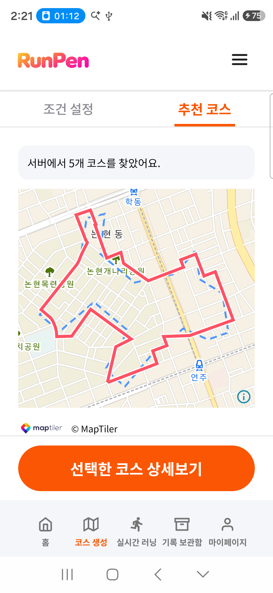
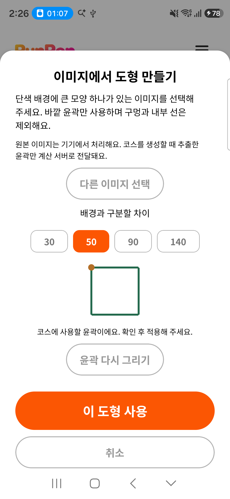
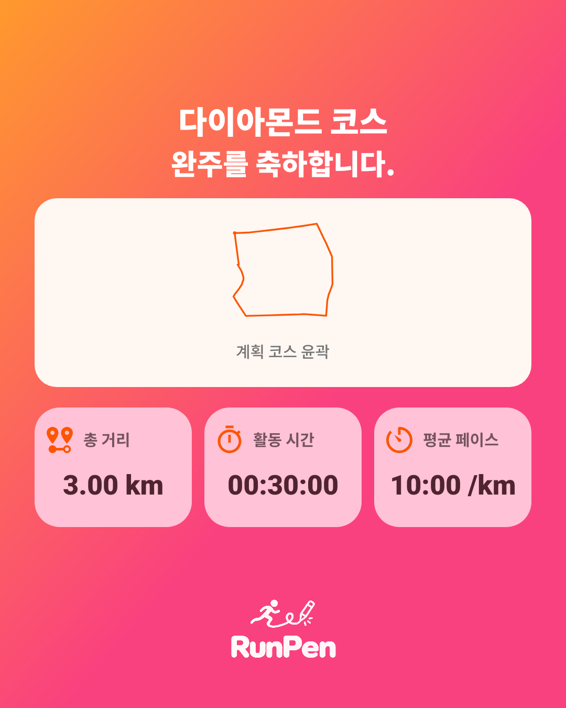

# 고사양폰 최신 기능 실내 후속 — 2026-10-17

SM-S942N(Android17)에 14:14:54 최신 APK를 동일 ID·서명으로 자료 유지 설치했다. 기존 **4코스·6러닝·1,907좌표·메모1개**, Google 로그인·동기화 선택·계정 설정을 설치 직후와 시험 정리 후 내용 해시까지 대조했다. 최종 확인은 `2026-10-17T14:41:13+09:00`이며 러닝 서비스·시험 자료·도우미·내부 복구본 정리를 마쳐 USB를 분리할 수 있다.

APK는 `running-art-0.1.0-20261014-achievements-service.apk`, SHA-256 `83f4e7f568d408da5eb1bdee7ac06e331dfa11c1c8f64b2258e3f4510447375c`다. 기존 설치는 10-14 08:20:57, 이번 설치는 10-17 14:14:54다. 최초 설치 시각과 자료 경로는 유지했다. 제품 코드/APK 재빌드·운영 서버/SQL 변경은 없었다. 오전 서버 반영은 [별도 검증](operations-readiness-20261017.md)을 따른다.

## 코스 생성·저장·이미지

| 공개 강남 입력 | 실제 서버 전체 시간 | 후보 | 표시 거리 km |
| --- | ---: | ---: | --- |
| 강아지3km | 9.29초 | 5 | 3.09 / 2.99 / 3.12 / 3.02 / 3.04 |
| 딸기10km | 10.08초 | 5 | 10.95 / 10.73 / 10.89 / 10.93 / 10.72 |

두 결과의 후보 점수·노드13,614/도로15,363·탐색량은 같은 공개 입력 기준과 정확히 일치했다. 실제 화면에서 서버 실행을 확인했다. 단일 확인 결과이며 기종 성능 차이의 반복 통계가 아니다. 12도형과1~10km의 **22개 선택 컨트롤** 및 왕관10km 생성 확인/취소를 확인했다. 전체120조합의 휴대폰 실계산을 뜻하지 않는다.

강아지1순위3.09km를 고유 시험 이름으로 첫 터치 저장했고 중복 저장 방지, GPX OS 공유 선택창/취소, 같은 코스 러닝 준비, 재시작 후 정확히1건 재열기를 통과했다. 계정 업로드는 `remoteVersion=1, dirty=0`, 시험 코스/러닝 삭제 후 대기·충돌0건과 원본 복원을 확인했다.

고유256×256 사각형 PNG로 실제 Android17 사진 선택 → **완료** → 자르기 → 윤곽 미리보기 → 적용 → 사용자 도형 생성 확인/취소를 검증했다. 개인 사진은 선택하지 않았다. 해당 원본 이미지·정확한 MediaStore 행과 경로/시각/해시/크기를 확인한 임시 PNG2개만 정리했다. 이미지 윤곽의 서버 계산 실행은 포함하지 않는다.

## 성취·PNG·계정 지원

기존 기록에 고유 합성 종료 기록3건(완주2·중도 종료1)을 추가했다. 첫 완주 배지는 더 오래된 시험 완주로 연결됐고 삭제에 따라 배지 **2→1→0회**, 현재 연속일 **2→1→0일**을 확인했다. 원래 최장3일과 원본 기록 해시는 유지했다. 이는 실제 야외 완주가 아니다. 최초3건은 `dirty=0`으로 기기 내 검증했으며 뒤의 일시정지 시험을 앱에서 종료한1건과 재도전 사본은 정상 동기화·삭제까지 확인했다.

스토리1080×1920과 피드1080×1350 PNG, 기본 닉네임·날짜ON과 둘 다OFF, OS 공유/저장 취소, 고유 폴더에 실제 저장을 확인했다. 저장 파일은 스토리 미리보기와 바이트·SHA-256까지 같았다. 닉네임·날짜가 없는 피드 결과를 시각 확인했다. 공유 수신 앱은 선택하지 않았다. 시험 카드 캐시2개·검증 복사본2개·저장 PNG/빈 시험 폴더와 그 폴더에만 부여한 지속 권한1건, 시험 GPX1개를 정리했다. 기존 Downloads 목록은 그대로다.

밝게/어둡게/시스템 테마와 재시작 유지를 확인하고 원래 계정 설정을 정확히 복원했다. 소개·사용법·FAQ/GPS 답변, 로그인 문의 작성 화면, 5탭과 글꼴1.6배의 결과/안내 메뉴를 확인한 뒤1.0으로 되돌렸다. **공지·이용약관·개인정보·위치 약관은 운영 조회 오류 화면**이다. 실제 문의 제출·동의·정책 게시 성공으로 기록하지 않는다.

## 러닝·재도전 범위

공개 코스의 별도 **합성 일시정지 기록**으로 지도/집중 모드, 음성·화면 꺼짐 옵션 변경, 터치 잠금/1.2초 길게 눌러 해제, 앱 강제 종료 후 일시정지·집중/음성OFF/화면 꺼짐ON 복원을 확인했다. 앱에서 종료·결과 화면으로 이동하고 기록 상세의 저장·재도전으로 코스 사본/러닝 준비를 열었다. 사본과 종료 시험 기록의 업로드·삭제를 확인했다.

실내 준비 화면은 최신 위치 조건 안내와 비활성 시작 버튼을 확인했다. **실제 GPS 시작·이동·일시정지/재개·새 러닝 ID 생성까지 통과한 검사가 아니다.** 실제 GPS 기반 최신 S4 통합·야외 이동 정확도·장시간 무충전은 후속이다. 과거 [GPS 장시간 검증](gps-process-recovery-20261011.md)의 범위를 이번 최신 기능 실내 검사로 확장해 주장하지 않는다.

## 보존·진단 근거

원본 DB/WAL/SHM은 기기 내부 복구본으로 보호했고 전체 개인 DB·인증 정보를 PC로 내보내지 않았다. 최종4개 테이블 내용 해시·계정 식별 해시·계정 설정/동기화 선택이 시작과 일치한다. Wi-Fi/모바일 데이터/비행기 모드·글꼴1.0, 최초 설치·자료 경로를 유지했다. 시험 행·동기화 삭제 대기·충돌0, 임시 파일/폴더·미디어·권한·도우미·UI jar/덤프·내부 복구본을 정리하고 홈/서비스 없음을 확인했다. [정제 증거](s942n-phone-20261017.json)를 따른다.

ADB 제한 환경 실행·초기 미인식과 QA helper aapt2 제한은 호스트 실행/정상 인식으로 해결했다. Play Protect의 선택적 업로드는 ‘전송하지 않음’으로 두고 보호 기능은 변경하지 않았다. Android17 사진 선택의 완료 단계, 화면 밖/고정 버튼·비활성 버튼의 검증 도구 탐색, 설치 직후 두 UI 덤프의 접근성 등록 충돌은 로컬 도구를 보정해 순차 검증했다. 실패 로그를 보존했으며 제품 결함으로 오인하거나 첫 실행 성공으로 덮지 않았다. 원본 로그는 `.cache/s942n-phone-20261017/`에 있다.

## 공개 시험 화면

아래 화면은 공개 강남 코스·합성 이미지와 개인정보 표시를 끈 합성 러닝 카드다. 계정 이름·이메일·개인 사진 선택창·개인 위치 화면은 게시하지 않았다.

